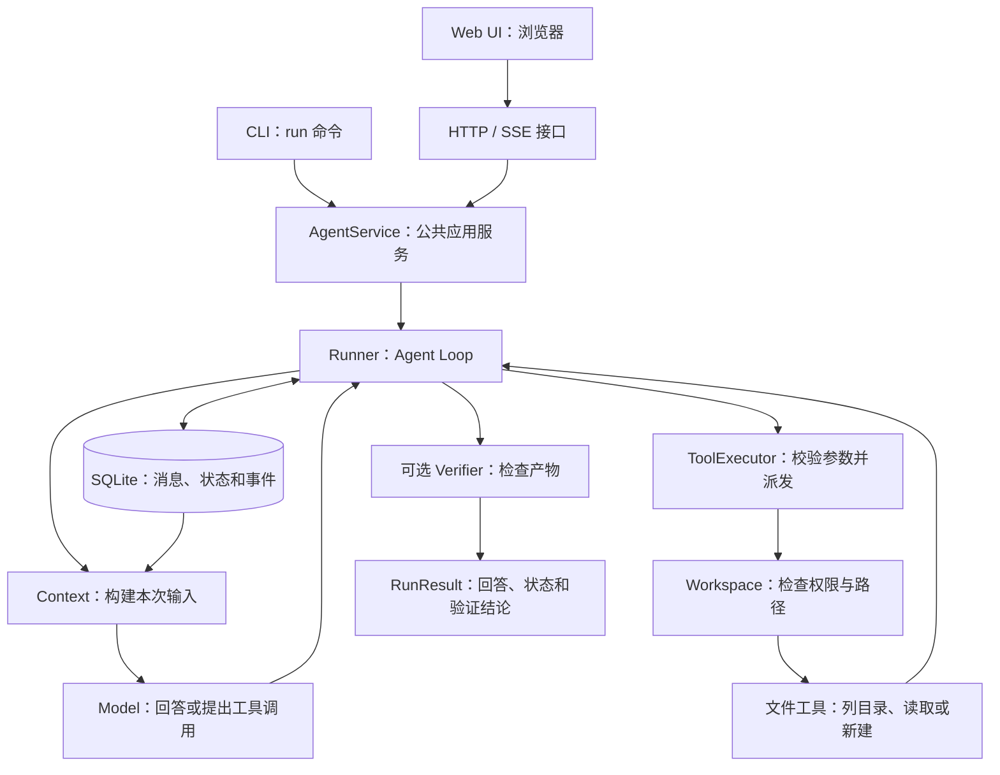

# Learn Agent：从一个循环开始

Learn Agent 是一个用于学习 Agent Harness 的 Python 项目，使用 uv 管理依赖。你可以通过浏览器或命令行提交任务，观察模型如何选择工具、读取执行结果并继续回答，也可以查看每次任务的会话历史和执行记录。

项目已经实现一个可运行的 MVP：它连接了模型、Agent Loop、文件工具、上下文构建、权限检查和 SQLite 存储，并提供 Web UI 与 CLI 两个入口。当前重点是把这些模块的职责和交互讲清楚，后续再逐步加入上下文压缩、长期记忆和恢复机制。

**想先体验系统，直接阅读下面的运行说明；想按课程学习，可以从项目内的 [START-HERE.md](START-HERE.md) 开始。**

## 1. 运行系统

运行前需要安装 uv，并准备 Python 3.12 或更高版本。以下命令均在项目根目录执行。

Web UI 和 CLI 是同一系统的两个入口，选择一个即可。`learn-agent serve` 启动 Web 服务，`learn-agent run "任务"` 在终端处理一次请求，两者都默认调用 DashScope 的 `qwen3.8-flash`，无需先运行另一个入口。也可以用 `--provider openai` 切换到配置好的 OpenAI 后端。

### 1.1 Web UI：推荐的体验方式

本机项目的 `.env` 已配置 DashScope，模型为 `qwen3.8-flash`。使用下面的命令安装依赖并启动服务：

```sh
cd /Users/drew/Documents/dev/learn-agent
uv sync --locked --extra web
uv run --extra web learn-agent serve --allow-write
```

然后打开 [http://127.0.0.1:8765](http://127.0.0.1:8765)。你可以先发送“读取 notes.txt，说明其中的学习目标”，观察工具调用进度，展开工具结果，再继续提问或切换历史会话。界面中的模型标签应显示 `DashScope · qwen3.8-flash`。

服务运行时需要保留这个终端，按 `Ctrl+C` 可以停止服务。启动命令中的 `--allow-write` 允许 Agent 在工作区内新建文件；如果只想读取文件和聊天，可以去掉这个参数。默认工作区是 `examples/workspace`，执行记录保存在 `.learn-agent/state.sqlite3`。

这里的聊天会调用真实模型。若要了解页面、后端接口和事件流如何协作，可以阅读 [Web UI 运行教程](docs/10-web-ui.md)与[模块交互说明](docs/11-web-architecture.md)。

### 1.2 CLI：在终端提交任务

如果你想观察命令行输出，或者从脚本中调用系统，可以使用 CLI。下面的命令与 Web UI 使用相同的 DashScope 适配器、应用服务和 Agent 核心；它不需要 Web 服务处于运行状态。

```sh
uv run learn-agent run "读取 notes.txt，说明其中的学习目标" \
  --provider dashscope --session flash-lesson-1 --trace
```

命令会显示 Run ID、Session ID、程序生成的系统结论、工具证据和检查范围，再单独展示模型说明。`--trace` 将进度事件写入 stderr，普通结果写入 stdout；需要结构化输出时，可以加上 `--json`。本例使用 `flash-lesson-1` 作为会话 ID，下一条请求带上相同的 ID，就能继续使用这段会话历史：

```sh
uv run learn-agent run "把刚才的学习目标改写成三个实践步骤" \
  --provider dashscope --session flash-lesson-1
```

Web UI 和 CLI 都通过应用服务访问 SQLite，因此会话和执行记录不依赖某个页面或终端窗口。继续已有会话时，需要使用与该会话匹配的模型、端点和工作区；更换这些配置后，应创建新会话。

### 1.3 完整任务：读取、生成与验证

要观察从读取资料到生成产物的完整链路，可以用真实模型创建一份报告。下面建立新的临时工作区，避免已有 `report.md` 影响创建和验收：

```sh
cd /Users/drew/Documents/dev/learn-agent
report_workspace=$(mktemp -d)
cp examples/workspace/notes.txt "$report_workspace/notes.txt"
uv run learn-agent run "先读取 notes.txt，再新建 report.md，报告必须包含来源文件中的验收标记" \
  --workspace "$report_workspace" --allow-write \
  --verify-file report.md --contains LEARN-42 --trace
```

指定文件检查通过时应显示 `status=completed verification=passed`，报告保存在临时工作区中。模型会根据请求和反馈选择工具，可能先列目录、补充读取或调整参数，因此以事件记录为准，不要求每次都有相同的调用数量或顺序。

文件验证器只检查报告当前是否包含指定内容，不能单凭通过结果认定文件由本次 Run 创建。使用新工作区，并结合工具结果和实际文件，可以更清楚地观察执行证据。

## 2. 系统如何工作

Web UI 负责显示聊天和进度，CLI 负责处理终端输入输出。它们把请求交给共同的 `AgentService`，由应用服务管理会话、运行配置和记录访问，再启动 `Runner` 执行 Agent Loop。因此，增加一个入口通常不需要复制模型调用或工具执行逻辑。



一次请求可能包含多轮模型调用：Runner 先构建上下文并请求模型；如果模型提出工具调用，就交给工具执行器检查参数和权限，再把真实结果放回历史，继续请求模型。循环在得到最终回答或达到运行限制时结束。模型只负责提出动作，是否允许执行以及如何执行，由程序控制。

SQLite 保存消息、工具交互和执行事件，Context 则从中选择当前请求要发送给模型的内容。两者的作用不同，因此以后可以改进上下文选择和压缩策略，同时保留完整执行记录。Verifier 检查实际产物，程序据此生成 `outcome`，作为用户首先看到的系统结论。`completed` 仍是循环状态；未检查时明确显示“结果未验证”，检查通过时只说明“已通过指定检查”。字段与证据边界见[结果与验收说明](docs/13-results-and-evidence.md)。

当前工具支持列出目录、读取文本文件和新建文件，不支持覆盖、删除或运行 Shell。写入权限默认关闭，开启后仍受工作区路径检查约束。这些检查不等同于操作系统沙箱。长期记忆、自动恢复和多 Agent 协作目前属于扩展设计，具体边界见[能力与限制](docs/04-boundaries.md)。

## 3. 接入真实模型

模型通过适配器接入共同的 `Model` 协议，Runner 不需要了解供应商接口差异。系统只提供真实模型后端，默认使用 DashScope `qwen3.8-flash`；缺少凭证、网络失败或模型拒答时会返回明确错误，不会回退到固定回答。

### DashScope

本机的 `.env` 已保存你提供的 API Key、业务空间端点和 `qwen3.8-flash` 模型配置，无需重复设置；这些本地配置已排除在 Git 和构建包之外。如果在新环境安装项目，请参考 `.env.example` 创建自己的 `.env`，填写 `DASHSCOPE_API_KEY`、`DASHSCOPE_BASE_URL` 和 `DASHSCOPE_MODEL`，然后使用第 1 节的启动命令。

DashScope 适配器使用 Chat Completions 接口，当前配置为非思考模式，并已验证真实的“模型提出读取工具调用 → 程序读取文件 → 模型返回答案”链路。更换模型、调整代理或排查连接问题时，可以参考 [DashScope 配置与验证说明](docs/12-dashscope.md)。

### OpenAI

OpenAI 适配器使用 Responses API，需要支持函数工具调用的模型。在本地 `.env` 中补充以下配置，替换其中的占位值即可；已有的 DashScope 配置可以保留。

```dotenv
OPENAI_API_KEY="替换为你的 API Key"
OPENAI_MODEL="替换为你的账户可用模型名"
```

使用 OpenAI 启动 Web UI：

```sh
uv run --extra web learn-agent serve --provider openai --allow-write
```

如果使用 CLI，则运行 `uv run learn-agent run "你的任务" --provider openai`。OpenAI 和 DashScope 使用各自的协议适配器，但会话管理、上下文、工具执行和记录方式相同。

### 配置加载与调用限制

`run` 和 `serve` 默认读取当前目录的 `.env`，不会向父目录搜索；已有环境变量的优先级高于 `.env`，命令行的 `--model` 又高于模型环境变量。如果从其他目录启动，需要指定 uv 项目、配置、数据库和工作区，具体示例见 [DashScope 教程](docs/12-dashscope.md)。修改配置后，需要重启 Web 服务；切换模型后应新建会话，旧会话仍保留原模型绑定。

真实模型调用会产生 API 费用。默认一次 Run 最多调用模型 8 次，每次最多请求 2048 个输出 Token；这些限制可以通过启动参数调整，更多说明见[运行边界](docs/04-boundaries.md)。

## 4. 怎样学习和扩展

不需要先读完所有文档才能运行系统。建议先完成一次交互，再沿着“理解系统 → 跟踪代码 → 修改一个模块 → 验证结果”的顺序学习：

1. 阅读[系统认知](docs/01-system-model.md)，对照最初的流程图理解 Harness、Loop、上下文与工具的关系。
2. 阅读[系统架构](docs/02-architecture.md)和[执行时序](docs/03-walkthrough.md)，跟踪一次请求经过哪些模块、传递什么数据。
3. 按[第一次工具扩展](docs/08-first-extension.md)增加一个工具，把抽象概念与实际改动对应起来。
4. 对照[扩展路线图](docs/05-roadmap.md)，选择下一个要改进的能力，并用其中的验收条件检查结果。

想先看最少的循环代码，可以运行 `uv run python examples/00_plain_loop.py`。这个示例只解释模型、工具和反馈如何形成循环；完整系统还包括应用服务、持久化、权限和运行限制。

各模块的教程会比较当前做法与其他方案，并给出适用条件、失败模式和练习。需要深入某个问题时，再按主题查阅：

- **控制流程**：[Loop、计划与 Graph](docs/tutorials/01-loop.md)，[多 Agent 与调度](docs/tutorials/10-orchestration.md)。
- **模型与工具**：[模型协议、流式与错误](docs/tutorials/02-model.md)，[工具设计与执行管线](docs/tutorials/03-tools.md)。
- **上下文与记忆**：[选择、压缩与检索](docs/tutorials/04-context.md)，[记忆的来源、更新与遗忘](docs/tutorials/05-memory.md)。
- **状态与权限**：[持久化与可靠恢复](docs/tutorials/06-state.md)，[权限、审批与沙箱](docs/tutorials/07-policy.md)。
- **扩展与质量**：[Skills、Hooks、MCP 和插件](docs/tutorials/08-extensions.md)，[观测、验证与评测](docs/tutorials/09-quality.md)。

运行相关的文档包括 [Web UI 教程](docs/10-web-ui.md)、[HTTP 与 SSE 模块交互](docs/11-web-architecture.md)、[DashScope 配置](docs/12-dashscope.md)以及[验证结果与未验证范围](docs/09-validation.md)。项目的参考依据见[来源与参考文档评议](docs/06-sources.md)，术语和表达习惯见[写作约定](docs/07-writing-and-glossary.md)；另有一份可选的[英文操作简表](docs/STE-QUICKSTART.en.md)。

路线图和模块教程同时包含现有实现与后续方案，阅读时请留意各节的实现状态，不能将所有设计都视为已经提供的功能。

## 5. 从哪些代码开始读

```text
src/learn_agent/
  application.py         Web / CLI 共用的执行与查询服务
  contracts.py           消息、工具调用、结果、限制和接口
  runner.py              Agent Loop 与停止条件
  context.py             上下文选择与大小限制
  policy.py              工作区路径检查与写入授权
  tools.py               参数校验与三个文件工具
  store.py               SQLite 会话、运行和事件记录
  verification.py        可选的文件内容检查
  config.py              本地环境加载与端点校验
  providers/openai.py    OpenAI Responses API 适配器
  providers/dashscope.py DashScope Chat Completions 适配器
  cli.py                 run、serve 等命令的入口
  web.py                 HTTP 请求与 SSE 适配
  web_runtime.py         后台运行任务的生命周期
  webui/                 HTML、CSS 与原生 JavaScript
```

建议先读 `contracts.py` 认识模块间的数据结构，再读 `runner.py` 看控制流程，接着阅读 `tools.py`、`policy.py` 和 `context.py`，最后研究模型适配器。想理解两个入口如何复用核心，再沿着 `cli.py` 或 `web.py` 进入 `application.py`。

## 6. 检查修改是否有效

模型 SDK 是基础依赖，Web 依赖按需安装。下面的静态检查和本地组件测试不调用模型；`-m "not live"` 只筛选无需模型的参数、文件、上下文和存储测试，不会用替代模型执行请求。

```sh
uv sync --locked --all-extras
uv run ruff check src tests scripts examples
uv run ruff format --check src tests scripts examples
uv run mypy
uv run pytest -m "not live"
uv run python scripts/check_docs.py
```

如果本机还安装了 Node.js，可以用 `node --check src/learn_agent/webui/app.js` 检查前端 JavaScript 的语法；运行 Web UI 本身不需要 Node.js 或前端构建步骤。文档检查器只检查本地链接和代码围栏，不能代替内容审阅或 Mermaid 图的渲染检查。

运行 `uv run pytest` 会包括标为 `live` 的真实模型集成测试，运行 `uv run python scripts/evaluate.py` 会用默认模型执行任务评测。这两条命令都会产生 API 调用；未配置的后端测试会明确跳过，不使用替身。结果和覆盖边界见[验证说明](docs/09-validation.md)。
