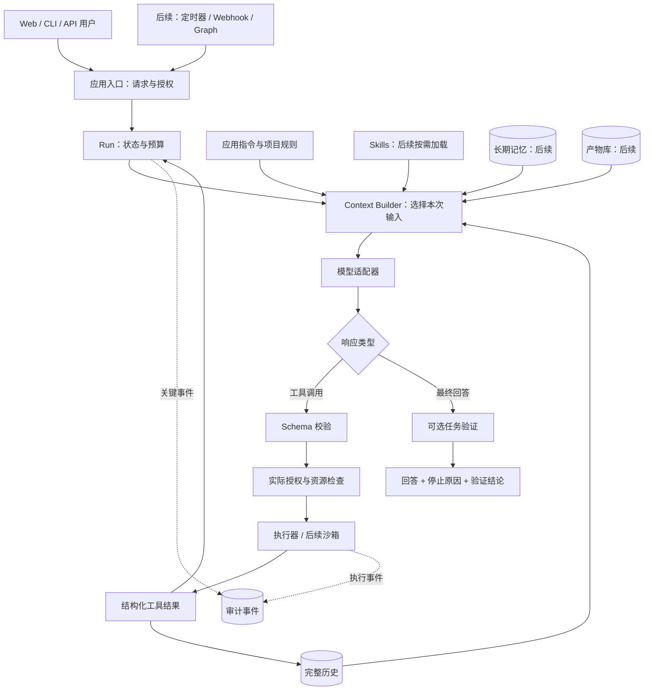
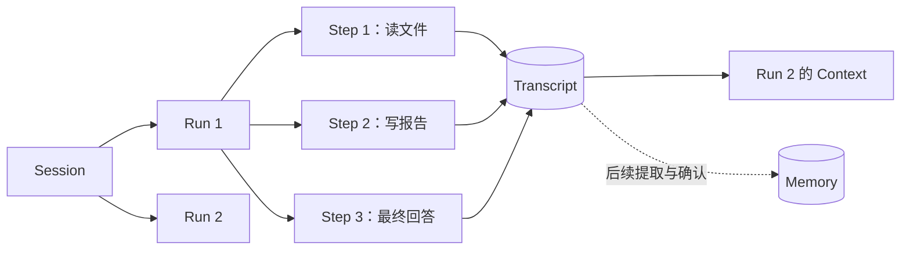

# 01. 建立系统认知

## 学习目标

本章从你最初的流程图出发，帮助你建立模型、运行系统和数据之间的关系。读完后，你应能解释以下三个问题：

1. 模型与 Harness 各自负责什么。
2. 一次工具调用怎样改变下一次模型输入。
3. 历史、上下文、记忆和产物怎样关联。

## 1. 从你的流程图出发

你的图已经包含“输入 → 模型 → 工具 → 工具结果 → 下一次模型请求”这条关键路径，也识别了 Skills、历史、长期记忆和观测能力。要把这张图变成可以实现和维护的系统，还需要明确下面几组边界。

**工具调用需要经过执行管线。** 模型输出的是工具名、参数和调用 ID，Python 函数由 Harness 检查权限后调用。因此，模型提出动作与程序执行动作是两个阶段，真实资源访问必须经过后一个阶段的约束。

**输入与动作各有检查位置。** 组装上下文时，需要区分应用指令与不可信资料；实际执行动作前，还要检查资源、参数和授权。只在 Context Manager 中处理输入，无法保护后面的文件系统或外部 API。

**同一段交互会产生多种历史视图。** 完整记录用于追溯，近期消息用于延续对话，摘要用于节约输入空间，长期记忆则用于跨会话复用知识。它们的来源可能相同，但更新规则和用途不同，因此应分别管理。

**产物需要独立存储和引用。** 报告、补丁和截图可以保存在工作区或产物库中，模型只读取当前任务需要的片段、版本和引用。这样既便于校验实际文件，也能避免在每轮请求中重复发送全部正文。

**观测与验证贯穿执行过程。** 事件需要在关键运行边界记录，验证则检查产物是否满足指定条件。这些能力可以通过独立适配器实现，但接口与证据应在主链路中保留，才能用于诊断和验收。

原图保存在 [reference-user-diagram.png](reference-user-diagram.png)。

## 2. 一个可逐步扩展的总图

下图描述目标系统。标有“后续”的部分没有在 MVP 实现。

这张图展示的是逐步扩展的方向。要先运行一个 MVP，只需要模型适配器、受控工具和有停止条件的循环；本项目又加入了记录与失败检查，方便你理解每一步。当前可用入口包括 Web UI 和 CLI，长期记忆等标注为“后续”的能力仍需逐步实现。

## 3. Harness、Loop、Graph 的关系

下面是本项目采用的工作定义，用于讨论职责与实现。它们不代表行业已经形成统一、互斥的分层标准。

**Harness** 是包围模型的运行系统，负责输入组织、动作权限、状态记录、停止条件和错误处理。**Agent Loop** 则是其中的一段控制流，重复执行“构建输入 → 调用模型 → 执行工具 → 接收结果”。

**外层任务循环**负责重复启动或唤醒 Agent，例如在 CI 失败后启动诊断。它与一个 Run 内的模型循环处在不同范围，设计调度器时需要说明触发、等待和停止分别由谁负责。

**Graph** 用节点、边和状态转移表达控制流。节点既可以是普通函数或人工审批，也可以运行完整 Agent Loop；一个 Graph 可以只包含一个 Agent，也可以组织多个 Agent，因此 Graph 和 Loop 可以组合使用。

**Framework** 提供构建系统所需的组件和抽象，同一个产品也可以同时提供 Harness。理解产品时，可以分别问它提供了哪些开发组件、哪些运行约束，而不必强行把它归入单一类别。

[Anthropic 的基础模式文章](https://www.anthropic.com/engineering/building-effective-agents)区分预定义工作流与由模型动态选择动作的 Agent。本文沿用这一思路，再单独讨论运行时需要补充的权限、状态和预算约束。

## 4. 区分六种数据

- **Session**：连续交互的会话身份。它可以包含多个 Run。
- **Run**：处理一个用户请求的执行过程。它可以调用模型多次。
- **Step**：一次模型请求，以及该响应提出的工具批次。
- **Transcript**：用户消息、模型响应和工具结果的完整顺序记录。
- **Context**：当前模型请求可见的输入视图。
- **Memory**：从过往材料中选择、确认并保存的可复用知识。

以聊天为例：同一会话是一个 Session；你先要求“分析文件”，再追问“整理成报告”，对应两个 Run。每个 Run 内可以多次调用模型，每次模型请求及其响应提出的工具批次构成一个 Step。

此外，**Artifact** 是工作区或产物库中的外部交付物，例如报告、补丁和截图。

**Event** 是对运行过程中关键节点的结构化记录，例如 Run 开始、模型请求返回、工具调用开始或结束。这里的“运行边界”指这些执行阶段的交接点或状态变化点。

在本项目中，普通事件保存的是描述执行过程的元数据，例如事件类型、时间、所属 Run、Step 编号、工具调用 ID、工具名和结果码；完整消息、工具参数与返回正文由 **Transcript** 保存。例如，一次 `read_file` 调用结束后，`tool.finished` 事件记录的是哪个调用结束了、是否成功及结果码，读到的文件内容则保存在 Transcript 的工具结果中。这样，Event 便于展示进度和排查执行状态，Transcript 便于追溯具体交互内容。事件是否包含正文取决于系统设计，“只保存元数据”是本项目的存储约定。

## 5. 一个常见误解

当模型回答“报告已生成”时，实际情况仍可能不同。要判断任务是否完成，需要沿着动作与证据继续检查：

1. 它根本没有调用工具。
2. 写工具被拒绝。
3. 文件生成了，但内容错误。
4. 文件存在，内容也满足指定验收条件。

系统应根据工具结果和实际资源检查给出主结论，并明确列出证据。MVP 因此优先返回程序生成的 `outcome`、工具记录和检查范围，模型文字单独作为说明；没有检查时结论为“结果未验证”，而不是默认完成。具体字段与行为见[结果与验收说明](13-results-and-evidence.md)。

## 自检

请画出“模型建议写文件，但程序拒绝写入”的路径，并指出错误结果怎样进入下一次模型请求。图中应包含工具执行器返回的拒绝结果；模型文字本身无法改变程序授权。
