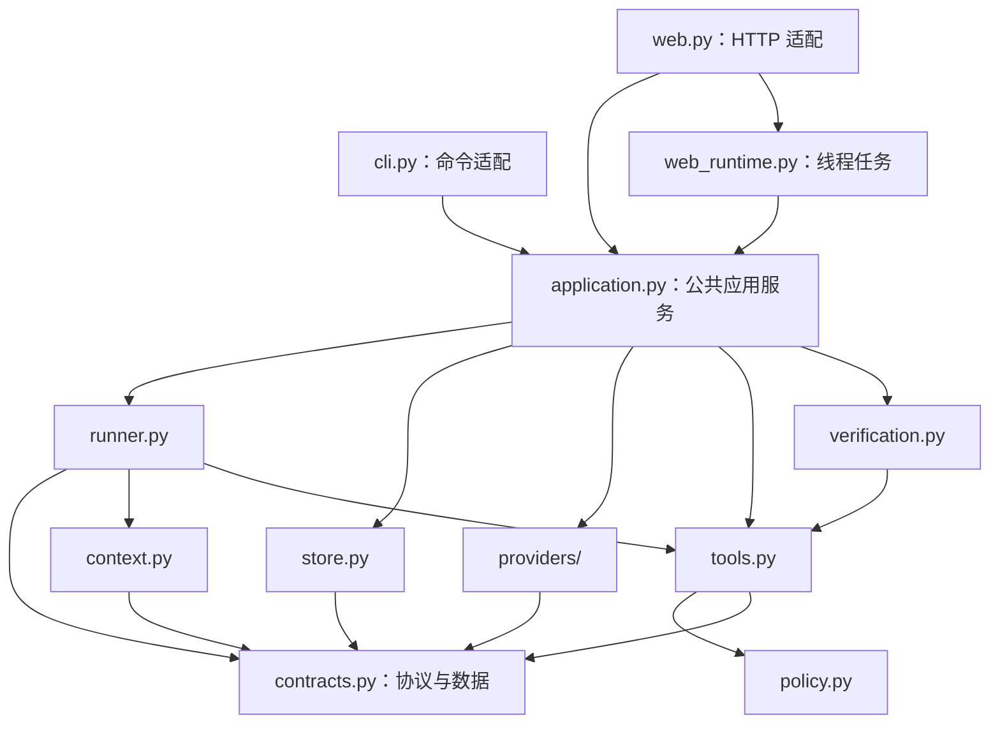
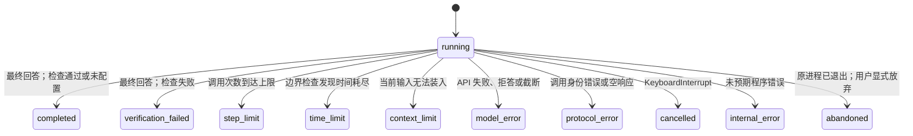

# 02. 架构与模块契约

## 1. 设计目标

第一版以可读、可运行和可替换为目标，采用一个 Python 包承载全部模块。这样可以通过职责和接口学习系统边界，暂时不承担多个服务、安装包与网络调用带来的额外复杂性。



图中的箭头表示导入依赖。`contracts.py` 不导入其他项目模块，Runner 通过 `Model`、`Store` 和 `Verifier` 协议使用适配器；工具部分暂时保留具体的 `ToolExecutor`，等确实需要独立执行后端时，再拆分注册表和执行端口。

## 2. 模块职责

### `contracts.py`

这个模块定义消息、调用、结果、运行限制和 Python Protocol，是各模块交换数据时共同使用的契约。`ToolCall.arguments` 保留模型返回的原始 JSON 字符串，由执行器在实际调用前重新解析和校验。

`Reply.provider_items` 用于保存特定模型协议的续接材料。Runner 不解释这些材料，只处理统一的工具调用和最终文字；因此，会话必须绑定兼容的模型后端，不能把不同供应商的历史混在一起使用。

### `runner.py`

Runner 负责读取历史、构建输入、请求模型、执行工具批次和保存结果，并拥有当前 Run 的可变状态。每个 Run 都创建新的 `RunState`，不同 Run 不共享消息列表。

Runner 通过统一接口派发工具，因此增加文件工具时只需修改注册表和执行实现，无需给循环增加工具名称分支。这样可以分别学习和替换控制流与业务能力。

### `context.py`

Context Builder 接收完整旧轮次、当前执行链、工具定义和输入字节上限，返回本次 `Context` 及省略轮次数、输入大小等信息。

输入超限时，它从最旧的完整轮次开始移除，同时保留当前执行链；如果当前链本身已经过大，就抛出 `ContextOverflow`。它不会改写数据库或生成摘要，因此原始记录仍然可供查询。

### `tools.py` 与 `policy.py`

执行器注册 `list_files`、`read_file` 和 `create_file` 三个工具，使用同一个 Pydantic 参数类型生成 Schema 并校验调用参数。通过参数检查后，权限模块再检查授权与路径，最后才执行文件操作。

参数错误、未知工具和常见 I/O 错误会转换成 `ToolResult`，让模型获得可理解的反馈；未预期的程序缺陷则由 Runner 记录为 `internal_error`，避免把内部故障当作普通任务结果。

### `store.py`

SQLite 保存会话绑定、Run、消息和顺序事件。`history()` 只自动返回状态为 `completed` 的 Run；失败 Run 的原始消息仍保存在数据库中，但不会自动进入后续上下文。

数据库中的 `running` 只表示最终状态尚未提交：进程可能仍在工作，也可能已经崩溃。判断外部动作是否发生时，还需要检查工具结果和实际资源，不能仅凭这个状态推断。

### `providers/`

`openai.py` 负责 Responses API 请求与续接材料，`dashscope.py` 负责 Chat Completions 消息与工具结果转换。系统仅连接真实模型，默认后端为 DashScope、模型为 `qwen3.8-flash`；选择与配置留在装配层，核心循环不包含模型名称。

`config.py` 在入口加载本地环境文件并校验端点，API Key 只由后端使用。远程适配器将 SDK 异常转换成公开错误类型名，避免完整异常正文进入普通事件。

### `verification.py`

验证器直接检查产物当前内容。现有检查器只读取前 8000 个字符，判断是否包含指定文字；它不能评价报告整体质量，也不能证明文件由本次 Run 创建。

### `application.py`

公共应用服务负责装配模型、工具、存储、检查器和 Runner，并提供执行任务、创建会话与查询历史等用例。CLI 与 Web 都调用这些用例，应用层本身不依赖 FastAPI 或浏览器状态。

### `cli.py` 与 `web.py`

CLI 将命令行参数转换为应用配置，在当前线程调用应用服务；Web 将 JSON 请求转换为同一套用例，通过 SSE 返回执行事件。`web_runtime.py` 在线程中执行同步用例并管理并发，`webui/` 负责输入与展示，完整交互见[Web 架构](11-web-architecture.md)。

## 3. 关键数据契约

一次模型请求返回：

```python
Reply(
    text="正在读取文件。",
    calls=[ToolCall(
        id="call_1",
        name="read_file",
        arguments='{"path":"notes.txt","offset":0,"limit":8000}',
    )],
)
```

这里的 `text` 是模型进度说明。`calls` 非空时继续执行工具；没有调用时结束模型循环，但业务验收结论仍由程序根据运行与检查状态产生。`RunResult` 同时保存 `outcome`、`tool_evidence` 与 `verification.checks`，让两种入口优先展示真实证据。

工具返回：

```json
{"ok":false,"code":"write_not_granted","data":{}}
```

工具结果通过 `call_id` 关联原始请求。Runner 会在执行整个批次前检查调用身份：批次内部不能出现重复 ID，当前 Run 中已见过的 ID 也不能再次使用。

## 4. 状态转换



`completed + unchecked` 对外显示 `outcome=unverified`，`completed + passed` 显示 `outcome=passed` 且列明检查范围，`verification_failed` 显示 `outcome=failed`。错误或限制导致停止时显示 `outcome=incomplete`，模型文字不会参与结论判断。

模型可能在工具失败后回答“未完成”，此时若没有配置检查器，循环仍可能正常结束。因此，应用应根据业务目标选择检查器，并结合工具证据判断结果。

## 5. 为什么现在不拆成微服务

当前系统面向本地单用户，核心是一个同步循环和三个文件工具。这个阶段引入独立 Worker、消息队列和远程存储，会增加故障点；先把一次工具调用的输入、执行和反馈看清楚，更有助于后续拆分。

出现以下需求时，再增加独立执行端口。

1. 工具运行不可信代码。
2. 任务要跨进程恢复。
3. 多个用户共享服务。
4. 工具调用需要独立的超时和资源回收。

出现这些需求后，可以让 Runner 发送执行请求，由 Worker 返回执行回执，同时保留 `ToolCall` 与 `ToolResult` 的身份关系。这样能替换执行方式，而不必重新定义模型如何观察结果。
