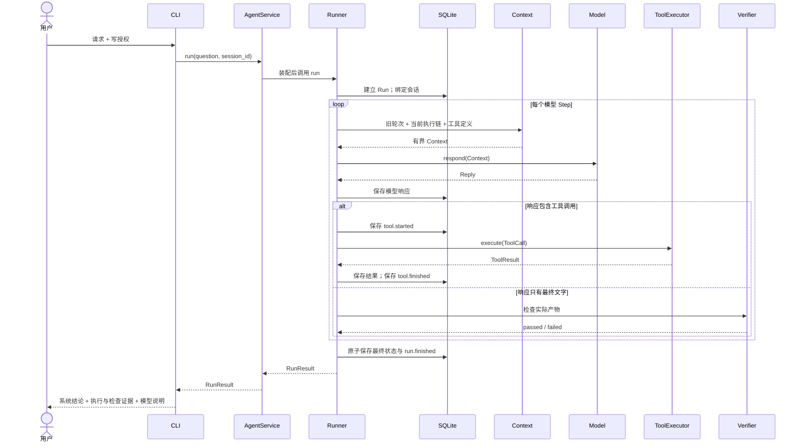

# 03. 跟踪一次执行

## 准备

本章跟踪 [README 完整任务](../README.md#13-完整任务读取生成与验证)：真实模型读取 `notes.txt`，创建包含验收标记的 `report.md`，再由程序检查产物。示例使用新工作区，避免旧报告影响结果。下面是典型路径，真实模型也可能列目录或补读，具体 Step 数量以事件记录为准。

## 1. 一次 Run 的时序



## 2. 读取来源

第一次请求包含应用指令、三个工具定义和用户要求。真实模型根据这些输入提出工具调用；在典型路径中，它先请求 `read_file` 读取来源文件，程序随后检查和执行。

Runner 检查调用 ID，保存模型响应并记录 `tool.started`，随后由 ToolExecutor 解析 JSON、校验参数并检查路径。读取成功的结果包含文本页、下一页位置、总字符数和 SHA-256，供后续判断内容与版本。

SQLite 中的当前消息顺序是：

```text
user(question)
assistant(call_id=A, read_file)
tool(call_id=A, ok=true, text=...)
```

工具返回的文字作为观察数据进入下一次请求，保留工具消息身份。应用指令要求模型把文件内容当作资料，真实的动作权限仍由执行器检查。

## 3. 创建产物

下一次构建 Context 时，输入已包含读取结果。模型可以据此组织报告，并提出 `create_file` 调用；这展示了工具输出怎样成为下一步决策的依据。

ToolExecutor 先检查 `--allow-write` 对应的程序授权，再检查路径和同名文件。实际写入使用 `open("xb")` 独占创建，因此已有文件不会被覆盖。

SQLite 继续追加：

```text
assistant(call_id=B, create_file)
tool(call_id=B, ok=true, path=report.md, sha256=...)
```

## 4. 提交回答

模型根据创建结果返回最终文字；当响应不含工具调用时，Runner 进入结束阶段。配置了检查器后，程序独立读取 `report.md` 并查找 `LEARN-42`，而不依赖模型对完成状态的声明。

最后，Runner 在同一数据库事务中保存最终 Run 结果与 `run.finished`。报告文件属于独立的文件系统动作，因此它的写入与数据库提交之间仍然存在故障窗口，后续恢复设计需要处理这个边界。

## 5. 查看事件

把 `RUN_ID` 替换为 CLI 显示的值。

```sh
uv run learn-agent inspect RUN_ID
```

典型任务的事件顺序如下；真实模型增加或减少工具步骤时，中间的模型与工具事件会相应变化：

```text
run.started
model.started
model.finished
tool.started
tool.finished
model.started
model.finished
tool.started
tool.finished
model.started
model.finished
run.finished
```

事件序号由 SQLite 生成，用于确定记录顺序；事件时间用于诊断，但系统时钟调整可能影响时间差。Runner 因此使用单调时钟实施运行时间限制。

普通事件只保存元数据，不重复保存文件正文和工具参数；完整消息字段会保存这些内容，因此数据库仍可能包含敏感资料。

## 6. 看一次失败

在仅含 `notes.txt` 的新工作区中重做任务，并去掉 `--allow-write`。如果模型仍调用创建工具，执行器会返回 `write_not_granted`；模型也可能直接说明权限限制。两种路径都不应产生报告，应结合事件与文件检查实际行为。

如果配置了产物检查器，报告缺失会使最终状态成为 `verification_failed`；若未配置，状态可能是 `completed + unchecked`。对比这两个结果，可以理解模型结束回答、循环正常结束与业务目标完成分别表示什么。

## 练习

1. 用 `--max-steps 1` 运行明确要求读取文件的任务。
2. 当模型提出读取调用时，确认随后以 `step_limit` 停止。
3. 确认没有新建报告。
4. 在数据库中找到已成功完成的读取调用。

验收条件：你能解释为什么“完成一个工具调用”不等于“完成用户任务”。
