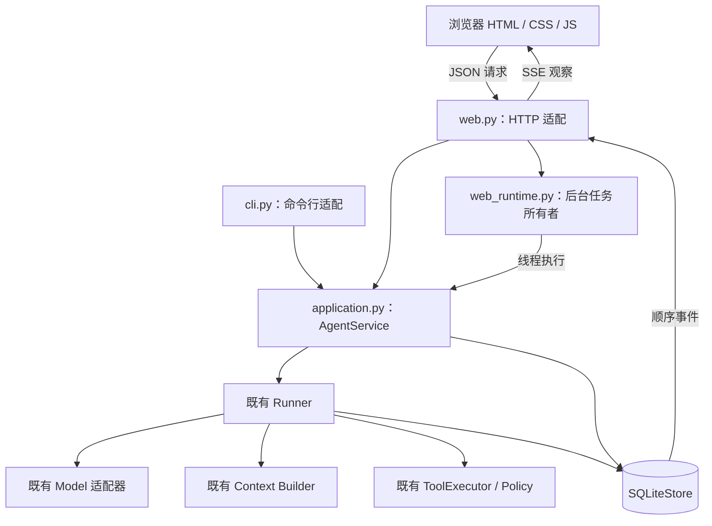
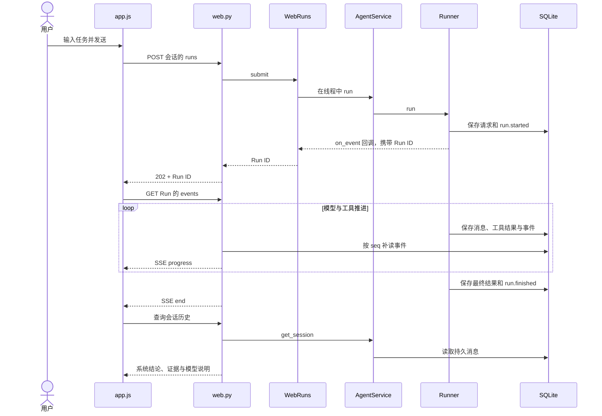

# 11. Web 与 CLI 的共同应用层

## 1. 新的边界

CLI 与 Web 使用不同输入协议，但都调用相同执行用例。模型 SDK、数据库与 Loop 保留在后端，前端只负责交互，HTTP 层也不按工具名称分派业务。

## 2. `application.py`

`AgentSettings` 保存服务使用的数据库、工作区、模型、权限和限制，不包含 HTTP Request 或 DOM 状态。CLI 入口先读取 `.env` 并转换命令行参数，再创建这份配置；本机默认模型是 DashScope `qwen3.8-flash`，模型选择因此由装配层传入。

`AgentService.run()` 统一装配模型、工具、存储、检查器和 Runner。CLI 在当前线程调用，Web 在后台线程调用，每次 Run 都创建独立模型与 SQLite 连接，并在结束时关闭。

应用层还提供创建会话、列出会话、分页历史和事件查询。`RecordService` 单独提供检查与放弃操作，让 CLI 的 `inspect` 不依赖当前工作区或 API Key。

数据库继续使用 v1 Schema。读取旧 Run 时会补齐结果字段，并根据原运行与验证状态重新推导 `outcome`；没有历史检查明细时不会补造证据。能否继续旧会话，仍取决于模型、端点和工作区绑定。

## 3. `web_runtime.py`

`WebRuns` 持有进程中的后台 Task，并限制同时运行的数量。同步用例通过 `asyncio.to_thread()` 进入工作线程，让 HTTP 事件循环在模型等待网络时仍能处理历史与进度查询。

Runner 开始后先保存请求和 `run.started`，后台线程通过线程安全回调将 Run ID 交给 HTTP 层，随后接口返回 `202`。这个响应确认任务已经接受，最终结果仍需继续观察。

Task 集合管理进程内生命周期，执行事实则保存在 SQLite。进程崩溃后，数据库仍可用于调查，但 Task 不会自动重建；可靠恢复还需要持久队列与动作协议。

## 4. 一次 Web 消息的完整时序

`run.started` 回调用于取得任务身份，SSE 随后读取已提交的数据库事件。因此，即使页面稍后才开始监听，也能补读已经发生的事件，避免依赖瞬时回调转发。

## 5. 为什么选择 SSE

当前交互主要是提交一次请求，再接收进度。普通 HTTP POST 可以提交任务，EventSource 则提供 SSE 观察、事件 ID 与重连，因此首版采用“POST 提交 + SSE 观察 + GET 查询”。

轮询接口更简单，但客户端需要管理间隔与重复读取；WebSocket 适合频繁双向控制，也需要额外消息和重连协议。选择 SSE 是基于当前进度展示需求，后续控制能力增加时可以重新评估。

SSE 每 250 毫秒补读已提交事件，每批最多 200 项，约每 10 秒发送保活注释。事件 ID 使用 SQLite 全局 `seq`，查询同时按 Run 过滤；重连处理 `Last-Event-ID`，新页面也可以从 0 重读并按序号去重。

## 6. HTTP 接口

- `GET /api/config`：只读的服务配置，不含密钥。
- `POST /api/sessions`：创建会话。
- `GET /api/sessions`：列出最多 100 个会话。
- `GET /api/sessions/{id}?before=N`：读取一页 20 个 Run。
- `POST /api/sessions/{id}/runs`：提交 `{"question":"..."}`。
- `GET /api/runs/{id}`：读取状态、展示消息和最终结果。
- `GET /api/runs/{id}/events?after=N`：读取 SSE 事件。

所有 POST 都需要 `X-Learn-Agent: web`，浏览器请求还要通过当前页面的同源检查。`409` 表示会话冲突或配置不匹配，`429` 表示 Web 并发达到上限，`422` 表示输入不符合要求。

## 7. 前端职责

`webui/index.html` 定义导航、聊天、输入与事件区域，`style.css` 负责桌面三栏与窄屏布局，`app.js` 管理选择状态、HTTP、EventSource 和纯文本渲染。它们不执行 Agent 决策。

`state.runs` 是页面展示快照，持久记录以数据库为准。`localStorage` 只保存选中 Session ID，不保存消息、授权或 API Key；清理浏览器本地状态不会删除服务端历史。

## 8. 验证边界

代码测试覆盖公共应用层、事件补读、并发和权限，CLI 子进程检查共享记录，浏览器实测检查发送、展开结果与刷新恢复。它们分别验证服务契约、入口互通与真实交互。

后续增加取消时，先在应用服务定义取消和资源回收契约，再由浏览器发起请求；仅关闭 EventSource 不会停止 Runner。增加登录时，还需要身份和会话归属过滤，才能扩展到多用户服务。

## 参考

[FastAPI 自定义响应](https://fastapi.tiangolo.com/advanced/custom-response/)说明 StreamingResponse 与文件响应。[FastAPI 并发说明](https://fastapi.tiangolo.com/async/)用于区分异步请求处理与阻塞工作。[MDN SSE 说明](https://developer.mozilla.org/en-US/docs/Web/API/Server-sent_events/Using_server-sent_events)说明 EventSource、事件 ID 与重连。
