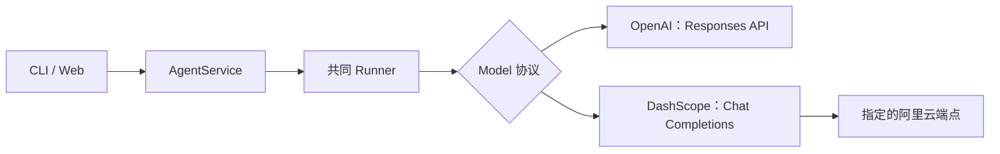

# 12. DashScope：本地配置与真实模型调用

## 1. 已配置的内容

项目根目录的 `.env` 保存本地配置，文件权限为 `0600`，不进入 Git 或构建包。它包含以下变量，本文不展示密钥值。

- `DASHSCOPE_API_KEY`：你提供的 API Key。
- `DASHSCOPE_BASE_URL`：你提供的新加坡业务空间端点。
- `DASHSCOPE_MODEL`：默认使用 `qwen3.8-flash`，已验证真实工具调用。
- `DASHSCOPE_USE_ENV_PROXY`：本地设为 `false`，直接连接端点。

模型列表已通过真实接口读取，包含 `qwen3.8-flash`。这个默认值用于当前学习项目，可以通过环境变量或命令行参数更换。

## 2. 启动 Web UI

```sh
cd /Users/drew/Documents/dev/learn-agent
uv sync --locked --extra web
uv run --extra web learn-agent serve --provider dashscope --allow-write
```

打开 `http://127.0.0.1:8765`，界面模型标签应显示 `DashScope · qwen3.8-flash`。本命令和所有执行入口均使用真实模型，会产生实际 API 调用；只读任务可以去掉 `--allow-write`。

默认 Provider 为 `dashscope`，不指定模型时依次使用已有环境变量、`.env` 和内置默认值 `qwen3.8-flash`，显式 `--model` 优先。所有执行入口使用真实模型，配置或调用失败会返回错误。

## 3. 使用 CLI

```sh
uv run learn-agent run "读取 notes.txt，说明其中的学习目标" \
  --provider dashscope --trace
```

显式指定模型，覆盖环境变量中的模型设置：

```sh
uv run learn-agent run "解释 Agent Loop 的作用" \
  --provider dashscope --model qwen3.8-flash
```

本次适配器使用千问的非思考模式，已验证 `qwen3.8-flash` 支持当前请求格式。更换其他模型前，应验证函数调用和 `enable_thinking` 参数的兼容性。

## 4. 配置如何生效

CLI 的 `run` 和 `serve` 默认读取当前目录的 `.env`，不向父目录搜索，也不执行 Shell 表达式。模型配置的优先级是：命令行模型参数 → 已有环境变量 → `.env`。

在其他目录运行时，可以同时指定 uv 项目、配置文件、数据库和工作区，继续使用项目中的配置与记录：

```sh
uv run --project /Users/drew/Documents/dev/learn-agent \
  learn-agent --env-file /Users/drew/Documents/dev/learn-agent/.env \
  --db /Users/drew/Documents/dev/learn-agent/.learn-agent/state.sqlite3 \
  run "解释工具调用的作用" --provider dashscope \
  --workspace /Users/drew/Documents/dev/learn-agent/examples/workspace
```

`--env-file` 与 `--db` 一样，放在子命令前面。修改 `.env` 后，需要重启 Web 服务；若 Shell 已导出同名变量，文件中的值不会覆盖它。会话会绑定模型，切换默认模型后请新建会话，旧会话的模型绑定不会被自动修改。

程序化使用 `AgentService` 时不会隐式读取文件，调用方应先调用 `load_environment(path)`，再创建服务。这使单元测试和嵌入式调用能够控制配置来源。

## 5. 为什么单独增加适配器



Responses 与 Chat Completions 的请求字段和工具消息格式不同，因此这两种远程协议各有适配器，不向 Runner 添加供应商判断。

DashScope 适配器将应用指令转换为 `system` 消息，将模型提出的调用转换为 `tool_calls`，并通过 `tool_call_id` 关联工具结果。请求明确指定 API Key 与 Base URL，禁用自动重试，并关闭思考模式；`reasoning_content` 不作为最终文字或上下文续接材料保存。

会话绑定包含模型名与端点摘要，因此即使模型同名，更换业务空间也不能静默继续原会话。更换 API Key 而端点与模型不变时，仍然使用同一会话绑定。

## 6. 网络代理

本机环境代理曾导致 SDK 连接失败，直接连接已成功，因此本地 `.env` 中设置了：

```text
DASHSCOPE_USE_ENV_PROXY=false
```

设为 `true` 时，HTTPX 读取环境网络配置，包括代理；设为 `false` 时使用直接连接，HTTPS 证书验证仍然开启。这个设置只作用于 DashScope 适配器。

## 7. 本次真实验证

`qwen3.8-flash` 已完成一次最小真实任务，测试使用临时工作区中的合成文件 `notes.txt`，没有发送项目凭证或私人资料。

1. 模型提出 `read_file` 调用。
2. 程序成功读取测试文件。
3. 模型根据结果返回 `QWEN38-FLASH-READY-42`，并指出来源为 `notes.txt`。

Run 状态为 `completed`，共 2 Steps；事件记录包含一次成功的 `read_file` 调用。接口报告累计输入 1659 Token、输出 119 Token，`usage_complete=true`。这些用量只对应本次测试，不是成本预测；本次未配置独立产物验证器，因此验证状态为 `unchecked`。

此前 `qwen-plus` 也通过了相同类型的工具调用测试，Web 服务配置接口曾验证不返回密钥。切换默认模型不会改变 Web 与 CLI 共用应用服务的架构。当前三个真实任务案例已全部通过，摘要见[本轮评测结果](../evals/results/qwen3.8-flash-2026-10-18.json)。需要重跑时执行：

```sh
uv run python scripts/evaluate.py --provider dashscope
```

该命令会运行评测任务并产生额外 API 调用。

## 参考

[阿里云 OpenAI Chat 接口兼容文档](https://help.aliyun.com/zh/model-studio/compatibility-of-openai-with-dashscope)说明 API Key、地域端点和 Chat Completions 接入方式。[阿里云函数调用文档](https://help.aliyun.com/zh/model-studio/qwen-function-calling)说明模型调用工具的交互格式。[python-dotenv](https://github.com/theskumar/python-dotenv)提供本地环境文件的解析与不覆盖现有环境变量的加载行为。
