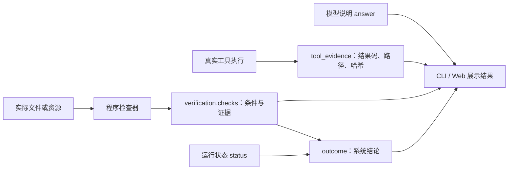

# 13. 返回实际结果：系统结论、证据与模型说明

## 1. 怎样理解“没有验证”

没有验证不等于实际没有完成，也不等于已经完成。它表示系统还没有足够证据作出验收结论。例如，模型可能确实创建了报告，也可能只是说已经创建；在检查工具结果与实际文件之前，程序不应将这两种情况统一显示为完成。

因此，用户首先看到程序生成的系统结论与执行证据，模型文字另标为“模型说明”。模型即使说“任务已完成”，也不能改变程序的结论。一般问答仍可展示模型回答，但没有配置对应检查时，状态保持“结果未验证”，不会暗示内容已经过事实核验。

## 2. 四种系统结论

- **`passed`：已通过指定检查。** 循环正常结束，且配置的检查通过。结论只覆盖明确列出的条件，例如指定文件前 8000 个字符中包含验收标记。
- **`failed`：验收检查未通过。** 指定检查失败，不能以模型的完成声明覆盖失败结果。
- **`unverified`：结果未验证。** 模型已经返回说明，但没有配置验收检查，系统无法确认任务通过验收。
- **`incomplete`：执行未完成。** 因错误、取消或预算等原因停止。已执行的工具操作仍可能有效，需要核对记录与资源。

内部的 `status=completed` 只表示模型循环结束，是执行引擎的状态；面向用户的结论使用 `outcome`。CLI 的退出码仍描述命令执行是否正常，自动化流程若要求验收通过，应明确检查 `outcome.status == "passed"`，并确认检查范围覆盖业务要求。

## 3. 谁产生哪些数据



模型输出先转换为统一 Reply，执行器返回真实 ToolResult，检查器再读取实际资源。`RunResult.outcome` 由运行状态和检查结果推导，模型的回答文字不参与这个判断。保存或读取结果时都会重新推导结论，避免调用方只修改一段 summary 就把未验证变成通过。

对外结果包含以下字段：

```text
RunResult
  status                 执行循环为什么停止
  outcome                程序生成的结论、标题与说明
  tool_evidence          已记录工具调用的结果码、路径和哈希
  verification.checks    具体检查名称、目标、条件与证据
  answer                 模型说明，不作为程序验收结论
```

工具记录描述当时观察到的执行效果，检查记录描述检查时的资源状态。文件之后仍可能改变，因此哈希和范围有助于定位证据，但不能保证资源永远不变。运行中断且没有保存工具结果时，也不能从记录缺失推断动作没有发生。

## 4. 当前文件检查能证明什么

使用 `--verify-file report.md --contains LEARN-42` 时，检查器会读取受限工作区中的文件，并记录检查目标、预期文字、实际读取字符数、读取结果码和文件哈希。CLI 会输出这些检查范围，Web 会在系统结论卡片中显示条件与证据。

如果通过，系统只显示“已通过指定检查”。这证明检查时文件可读，并且前 8000 个字符包含 `LEARN-42`；它不自动证明报告质量、全部用户要求或文件由本次 Run 创建。旧文件也可能通过，现有测试专门保留了这个边界。

运行结果还会列出真实工具记录，例如 `create_file report.md → ok`。它提供写入时的证据，但若需要严格证明当前文件就是本次产物，还应把创建回执、路径、版本和检查时的哈希关联起来，这是后续增强方向。

## 5. 如何继续完善

验收条件应从用户要求或业务规则明确建立。编程任务可以检查测试和构建，文件任务可以检查内容与版本，外部操作可以查询资源状态。对无法自动检查的要求，应保留未验证或交由人工评审，不能仅让同一个模型再说一次“已完成”就升级为确定结论。

当前 MVP 在最终回答后检查一次，失败就返回检查失败，尚无自动修复循环。后续可以加入带明确反馈的有限修复，但必须继续消耗原有 Step 和时间预算，最后仍由程序检查器决定是否通过。

相关代码是 `contracts.py` 中的结果契约、`runner.py` 中的执行证据收集、`verification.py` 中的实际检查，以及 CLI 与 Web 的展示。扩展验证方案可继续阅读[观测、验证与评测](tutorials/09-quality.md)。
