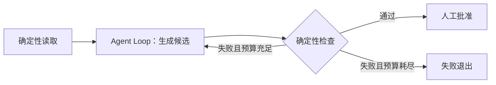

# Loop：让模型行动，并明确停止

## 1. 本模块解决什么

Loop 负责决定下一步调用哪个组件、何时继续、何时结束。它接收用户请求、历史和限制，返回回答、停止原因与执行记录；每个工具的业务逻辑则留在工具模块中，让控制流程保持清楚。

## 2. MVP 的做法

在 `src/learn_agent/runner.py` 中找到 `for step in range(...)`，可以看到每轮先构建 Context 并请求 Model，遇到调用就执行工具、追加结果，只有文字时则运行可选检查器并结束。

当前版本通过原生函数调用接收动作与参数，因此不需要解析 `Thought:`、`Action:` 等标签，也不要求模型公开完整推理过程。学习时重点观察可执行调用与真实结果怎样衔接。

## 3. 三种控制策略

### 方案 A：模型自主选择动作

自主策略让模型根据每轮观察选择工具或直接回答，适合下一步会随反馈变化的任务。它的控制代码少，但路径与动作数量较难预估，因此仍需由程序约束权限和预算。

MVP 采用自主策略，便于用最少控制代码观察模型决策。更强的模型可能改善质量，程序中的权限、停止条件和结果检查仍应独立保留。

### 方案 B：先计划，再执行

计划策略先产生步骤，再由执行器处理当前步骤，并随观察变化重新规划。它适合展示依赖、进度和预计范围，但计划本身也需要作为可更新状态管理。

可以先增加 `update_plan` 工具，验证可见计划是否有助于执行，再决定是否引入独立规划器。计划中的完成状态是过程声明，最终产物仍需检查。

### 方案 C：显式工作流或 Graph

工作流或 Graph 由程序定义关键节点与转移条件，例如“读取资料 → 生成候选 → 人工批准 → 发布”。节点内部仍可使用自主 Loop，让固定业务边界与动态决策分别承担合适的职责。

这种方式适合固定审批、稳定流程和持久等待，但需要维护状态 Schema、节点版本与恢复语义。Graph 使路径更明确，安全与正确性仍取决于节点和执行边界的实现。

## 4. 停止条件怎样组合

最终回答是停止条件之一，程序还应处理调用次数、时间、取消与任务验收。后续可以加入累计 Token、费用、工具次数和无进展检测，并让这些限制共用运行预算。

结束 Run 时应保留明确原因，达到预算就报告相应限制。普通工具错误可以交回模型继续处理，程序状态损坏则应停止，避免让模型猜测恢复动作。

## 5. 验证循环放在哪里

有两种常见做法。

1. 在最终回答后检查。失败则返回失败，交给用户处理。
2. 检查失败后，将结构化反馈送回同一个 Run，让模型修复。

MVP 在最终回答后检查，失败就直接返回，便于观察验证边界。若加入自动修复，应另设修复次数上限，并继续消耗原 Run 的 Step 和时间预算，避免外层循环绕过限制。

## 6. 常见失败

**不断重复同一调用。** 相同参数不一定意味着无进展，例如轮询 CI 需要重复读取。判断是否停止时，应结合状态变化、重复错误次数与等待间隔。

**每个任务都强制十步计划。** 小任务可能因此增加调用和状态维护成本，可以先确认计划是否帮助了执行或进度解释，再决定启用范围。

**把进度文字当成最终回答。** 模型提出工具调用时也可能附带文字说明，本项目只有在调用列表为空时才将文字视为最终回答。

## 7. 动手练习

增加一次有界修复。

1. 检查器失败时，生成带来源标签的反馈消息。
2. 允许模型继续执行一次修复。
3. 保留原有总 Step 和时间限制。
4. 再次失败时，返回 `verification_failed`。

**验收条件：** 使用真实模型执行会触发产物检查的任务，在有限总预算内观察修复和最终状态。记录实际路径，确认验证失败不会被模型的完成声明覆盖；无法稳定触发的分支单独列为未验证。

参考：[基础控制模式](https://www.anthropic.com/engineering/building-effective-agents)。
