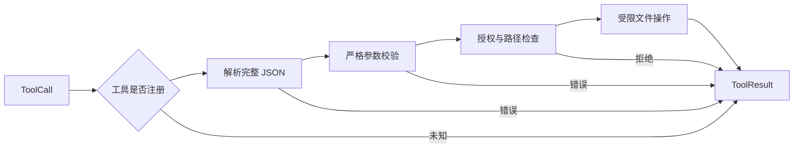

# Tools：把建议变成可检查的执行

## 1. 工具契约

工具由名称、用途、参数 Schema、执行函数和结构化结果共同构成。模型通过定义了解可提出什么动作，真实函数则保存在执行器注册表中，不能由模型通过同名文本临时替换。

## 2. MVP 管线

工具定义与本地校验共用一个 Pydantic 类型，减少 Schema 与代码不一致的机会。即使服务端启用严格模式，执行器仍要重新验证实际输入。

`read_file` 只读取不超过 256 KiB 的 UTF-8 普通文件，每页最多 8000 个字符，并返回下一页位置与完整文件哈希。分页按字符计数；MVP 没有强制检查各页属于同一版本，调用方可比较哈希发现变化。

`list_files` 只列一层目录，最多检查 1000 项、返回 200 项，超出时标记 `truncated=true`。当前没有目录续页接口，大目录的完整访问仍需后续扩展。

`create_file` 最多接收 16000 个字符，不创建父目录或覆盖文件。如果写入时发生异常，磁盘上仍可能留下部分内容，因此需要结合实际状态解释 `io_error`。

## 3. 工具粒度有三种选择

### 方案 A：少量通用工具

通用工具以 Shell 为代表，模型可以组合已有命令，覆盖面广；相应地，授权分析、超时、进程管理和输出限制也更复杂。允许任意命令需要执行隔离，不能只维护危险字符串名单。

### 方案 B：专用结构化工具

专用工具如 `read_file`、`create_file` 或 `query_build_status`，参数和错误更明确，也容易限制资源范围。MVP 采用这一方案，工具增长后再关注 Schema 占用、命名与维护成本。

### 方案 C：高层业务工具

高层业务工具如 `prepare_release_candidate`，可组合多个确定性动作、减少模型往返。由于隐藏了内部步骤，应明确幂等语义、失败边界和回执，方便外部判断实际效果。

[工具设计实践](https://www.anthropic.com/engineering/writing-tools-for-agents)强调清楚的用途、低歧义参数和可用于后续决策的结果。

## 4. 串行与并行

MVP 按响应顺序串行执行调用，便于理解日志、取消和副作用顺序。需要提高吞吐时，可以先并行无冲突的只读动作。

并行前，每个工具应声明效果与资源范围，同一资源上的读写需要排队，外部服务也可能共享限流额度。第三方工具仍需注册审查或受限执行环境，名称包含 `read` 不能证明实现只读。

## 5. 大结果与产物

读取工具的大文件时，可选择两种方式。

1. 工具自行分页，模型逐页读取。
2. 保存完整结果，返回有限预览、结果 ID 和读取工具。

分页实现直接，但可能重复读取；保存完整结果再返回引用，则适合昂贵查询和不可重现结果，同时需要管理归属、版本与生命周期。结果 ID 应绑定会话、调用和内容版本，不能使用任意本地路径冒充可信引用。

## 6. 后续写入方案

精确替换可以作为后续编辑方案：传入路径、旧文本、新文本和预期哈希，确认版本与唯一匹配后，再写临时文件并原子替换。这样能发现一部分外部修改，并减少半写入内容的暴露。

进程内锁无法排除外部编辑器，需要更强一致性时，可以考虑隔离工作树、版本提交或存储端条件更新。普通的先检查后写入仍然存在竞态。

## 7. 动手练习

增加 `search_text` 工具。

1. 参数使用普通字符串，不执行模型提供的 Shell。
2. 限制目录深度、文件数量、文件大小和返回字符数。
3. 跳过符号链接与保护目录。
4. 返回路径、行号、命中片段和截断标记。

**验收条件：** 无结果、中文、大文件、越界路径与符号链接都有明确反馈，新增工具只修改注册与执行层，Runner 无需增加名称分支。
