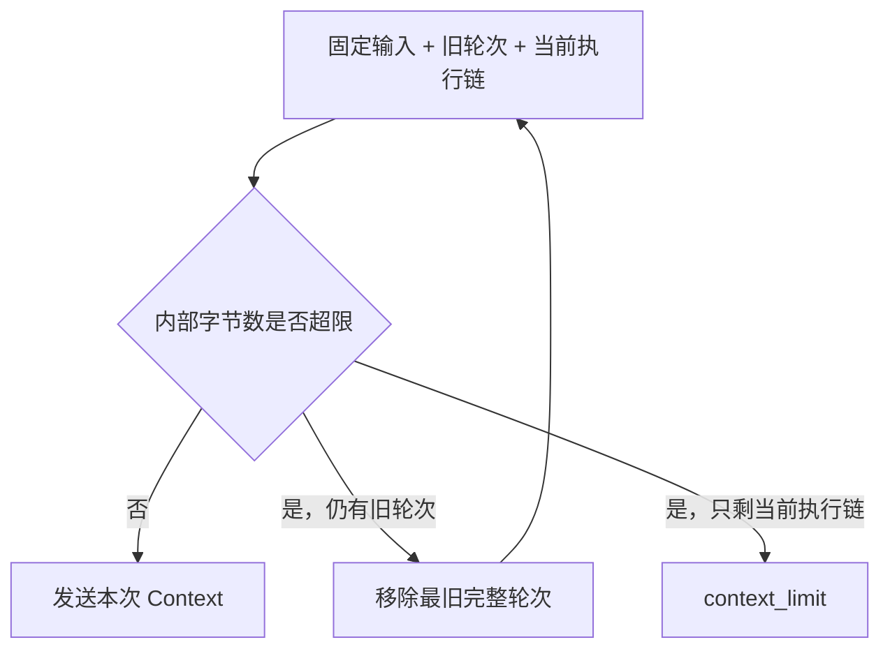

# Context：选择本次模型应看到的内容

## 1. 先区分存储与输入

Transcript 保存原始交互，Context Builder 为本次请求选择输入。压缩与检索可以改变当前可见内容，但应保留原始记录，便于追溯遗漏和摘要失真。

当前输入由应用指令、旧完整轮次、当前执行链和工具定义组成，尚未自动加载 `AGENTS.md`、Skills 或长期记忆。增加来源时，需要同时定义身份、信任边界与预算。

## 2. MVP 为什么按整轮移除

旧轮次包含用户请求、模型调用、工具结果和最终回答。输入超限时，Builder 从最旧轮次开始移除，加入历史省略提示后重新计算大小。

当前执行链始终保留，避免只留下工具结果却失去对应调用。如果当前链本身超限，Run 以 `context_limit` 停止；虽然损失部分长任务能力，但协议边界明确、容易测试。



## 3. 方案 A：保留最近完整轮次

保留最近完整轮次确定、便宜且易测试，适合短会话和独立任务。不过早期约束也会随轮次移除，例如首轮指定的报告格式可能在后续丢失。

可以先将明确任务约束保存到结构化状态中，减少对最早消息始终在窗口里的依赖。由模型提取的约束仍需来源，动作执行也仍须按真实授权检查。

## 4. 方案 B：摘要 + 最近原文 + 当前链

摘要策略压缩较早完整块，同时保留近期原文和当前工具链，适合持续修改同一目标的任务。它减少重复输入，也引入额外调用、摘要失真和版本维护。

建议摘要 Schema 包含：

```text
summary_version
source_message_ids
source_hash
goal_and_constraints
confirmed_facts[{value, source_id}]
completed_work
open_work
failed_attempts
uncertainties
artifact_refs
```

来源 ID 与哈希由程序生成，摘要模型只负责内容。摘要不能改变授权，失败时应保留原文并按明确策略继续或停止。

摘要应保留数值、路径、错误、未解决问题与来源，“已经查过”往往不足以继续决策。近期原文可补充证据，但还需要约束召回评测才能判断压缩效果。

## 5. 方案 C：按需检索

检索策略先保留路径、标题、结果 ID 与概览，再由模型调用工具取得原文。它把窗口用于当前问题，不过会增加检索成本与工具往返。

可采用以下检索方式。

- 关键词与 SQLite FTS：实现直接，适合路径、标识和明确词语。
- 向量检索：适合语义相近但词语不同的问题，需要 Embedding 和索引更新。
- 混合检索与重排：可组合精确命中和语义召回，代价更高。
- Agent 自主搜索：适合动态仓库，但会增加模型与工具往返。

MVP 已有文件读取，下一步可以先加关键词搜索，再根据真实召回问题决定是否引入向量索引，分别测量收益和维护成本。

[上下文工程实践](https://www.anthropic.com/engineering/effective-context-engineering-for-ai-agents)讨论了按需读取、压缩和外部笔记。本教程将这些思路分成可独立测量的阶段。

## 6. Token 预算怎样实现

后续可以增加 `TokenCounter` 接口，让它接收实际供应商请求形式。工具定义、协议项、图片和输出预留都可能占用窗口，只计算用户文字会漏掉重要部分。

若窗口为 W、输出预留为 O、协议余量为 S，可用输入约为 `W - O - S`。参数和计数规则必须匹配实际模型，统一字符比例无法提供精确预算。

分词器也可能忽略服务端模板开销，可以优先使用供应商计数接口，或加入保守余量，并记录估计、实际用量与偏差来校准。

## 7. 大结果与缓存

固定指令、规则和工具定义可以形成稳定前缀，把变化频繁的进度放在后面。这可能改善前缀缓存，但收益要用具体服务报告的缓存字段验证。

大结果优先使用分页或外部引用。预览截断时要明确标记、提供补读路径，并保留错误、关键数值与结果身份，避免模型将预览当作全部事实。

## 8. 动手练习

先实现纯函数 `select_complete_blocks()`。

1. 用消息 ID 表示一个完整模型响应及全部工具结果。
2. 只在完整块边界压缩。
3. 保留当前用户请求与未完成调用。
4. 不修改原始消息。

用同一组长会话比较裁剪与摘要：在最早轮次放入“报告必须包含 UTC 时间”等约束，在末轮检查是否保留，并定位遗漏位置。

**验收条件：** 同时统计约束召回、来源准确性、输入 Token 和额外摘要成本，衡量压缩带来的收益与代价。
