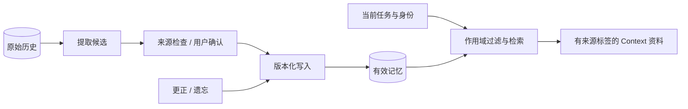

# Memory：保存可复用知识，并允许更正

## 1. 记忆不等于数据库历史

历史保存执行原始记录，长期记忆保存经过选择、能在以后复用的知识。可靠复用还需要来源、范围、版本和有效期，因此只保存聊天记录还不构成完整的记忆系统。

MVP 当前只通过 SQLite 延续同一会话，没有长期记忆。下面比较的是后续方案，可以从用户显式维护开始，再逐步增加自动提取。

## 2. 从最便宜的方案开始

### 方案 A：用户维护的 Markdown

Markdown 方案由用户维护事实和偏好，每个 Run 先加载有界概览，再按需读取正文。它容易审查与版本管理，适合单用户学习系统。

采用这一方案时，还需约定冲突、更正、删除与来源索引。正文应作为背景资料加载，避免整份记忆长期占据高权限指令。

### 方案 B：结构化条目 + 关键词检索

结构化方案用 SQLite 保存条目、来源、版本与作用域，正文可放在数据库或 Markdown 中，再按关键词、项目和类型检索。它便于更正、撤销和追溯，是本项目可优先尝试的下一步。

### 方案 C：向量或混合检索

向量或混合方案为条目建立语义索引，适合知识量大、表达多变的场景。它增加 Embedding、索引一致性和权限过滤成本；相似度只能说明语义接近，事实仍需来源支撑。

### 方案 D：自动提取和后台整理

自动提取先从历史生成候选，再合并到正式记忆，适合人工维护开始困难的规模。它可能把猜测或一次性要求误存为事实和长期偏好，因此早期应由用户确认候选。

## 3. 建议的数据结构

```json
{
  "id": "memory_001",
  "scope": {"user_id": "local", "project_id": "learn-agent"},
  "kind": "project_fact",
  "text": "项目使用 uv 管理依赖。",
  "source_ids": ["run_x/message_1"],
  "version": 1,
  "status": "active",
  "created_at": "2026-10-18T00:00:00Z",
  "expires_at": null,
  "human_edited": true
}
```

条目 ID、作用域和版本由程序生成，事实、偏好和经验使用不同类型，分别定义更新与失效规则，避免把一次成功经验当作长期事实。

## 4. 写入路径和读取路径分开



先确定权限和作用域，再在允许范围内检索与重排，避免其他用户的内容进入结果后才试图用 Prompt 隐藏。

记忆片段带来源、版本与有效状态，作为背景资料进入 Context；授权则独立归 Policy 管理。例如，记忆中的“用户同意发送邮件”不能证明当前动作仍有有效授权。

## 5. 更正与遗忘

同一事实可能冲突，例如旧条目写 Python 3.11、新条目写 Python 3.12。可将旧条目标为 `superseded`，保留证据与替代关系，方便追溯变化。

用户要求遗忘时，至少处理三处。

1. 正式条目停止参与检索。
2. 检索索引删除或失效。
3. 提取流水线记录来源撤销，避免下次从旧历史再生成同一条记忆。

还要明确是否删除原始历史：记忆遗忘与审计保留的目的不同，界面应说明实际范围，并防止后台从旧来源重新提取已遗忘内容。

## 6. 记忆怎样失效

时效随知识类型变化：CI 当前失败等状态需要短有效期，稳定偏好可长期保留但允许覆盖，外部事实应记录核对时间和来源。

摘要和模型生成内容可以形成候选知识，但不能自动成为长期事实或用户确认。提取、确认与正式写入应分别保留证据。

## 7. 动手练习

先增加显式 `remember`、`recall`、`forget`，把作用域、版本与遗忘做清楚，再考虑后台自动提取。

验收条件：

- 新会话可以读取当前项目的有效记忆。
- 另一项目默认无法读取该记忆。
- 更正会生成新版本并保留来源关系。
- 忘记后，旧条目和索引均不再参与输入。
- 记忆不能修改工具写授权。

显式流程稳定后，再评测提取准确率、错误写入率与遗忘后重新出现的比例，确认自动化是否减少了维护成本。
