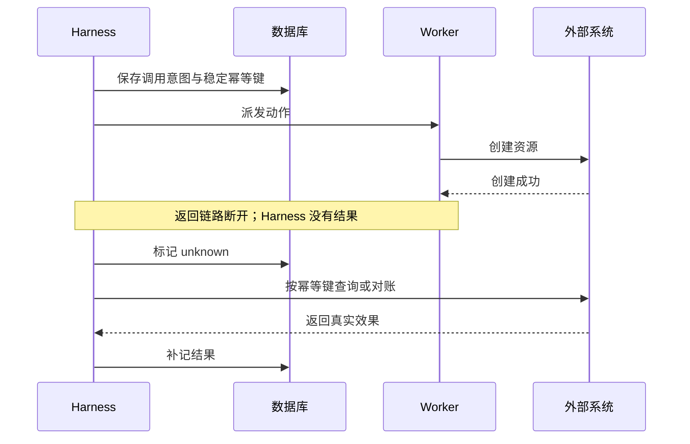

# State：记录进度，并正确处理未知效果

## 1. MVP 保证什么

MVP 在模型响应后保存完整响应，执行工具前记录 `tool.started`，工具返回后保存结果并记录 `tool.finished`，最后在同一 SQLite 事务中提交最终状态与 `run.finished`。这些边界让你能够重建执行顺序。

现有记录用于追溯，还没有构成自动恢复与执行回执协议。数据库提交和文件操作也不在同一事务中，因此下面的身份、对账和恢复策略都属于后续设计。

## 2. 三种状态方案

### 方案 A：仅内存状态

仅内存状态实现最少，适合一次性演示；进程退出后状态消失，因此不适合昂贵或有副作用的长任务。

### 方案 B：快照 + 执行账本

快照回答下一步应从哪里继续，账本保存某个动作实际发生了什么。两者结合更便于逐步增加恢复能力，单独保存 `step_index` 再重做后续工具，无法判断动作是否已经执行。

### 方案 C：事件日志 + 状态投影

事件日志将运行事实追加保存，再通过投影重建可查询状态，适合复杂恢复和多个消费者。代价是维护事件版本、重放规则与投影升级；外部动作的幂等和对账仍需单独实现。

## 3. 先定义执行身份

后续可以增加 `Invocation`。

```text
invocation_id       一个逻辑动作
run_id / step_id    动作所属执行位置
call_id             对应模型调用 ID
tool_version        实际工具实现版本
arguments_hash      已确认参数的摘要
effect              read / write / external
attempt_id          一次实际派发
status              prepared / dispatched / succeeded / failed / unknown
receipt_ref         执行端保存的回执
```

同一逻辑动作的重试复用 `invocation_id`，每次实际派发则使用新的 `attempt_id`。外部幂等键应绑定逻辑动作，使多次尝试仍指向同一效果。

## 4. 为什么需要 unknown



Harness 没收到结果时，外部动作可能成功也可能失败，直接记为失败并重试会产生重复资源。`unknown` 因此表示需要查询回执或对账，恢复前先消除效果上的不确定性。

## 5. 恢复决策

- 已保存成功结果：复用结果，不再次执行。
- 只读动作且没有结果：检查时效后，可重新读取。
- 尚未派发的写动作：重新检查版本、权限和前置条件。
- 已派发但结果不明：先查询回执与外部状态。
- 外部系统支持幂等键：使用原键重试或查询。
- 外部系统既不支持幂等，也不能查询：暂停并要求人工核对。

恢复时还要检查工具版本、模型协议和权限是否兼容。授权被撤销后不能继续使用旧授权，外部数据变化后也可能需要重建 Context 和前置条件。

[LangGraph 持久化文档](https://docs.langchain.com/oss/python/langgraph/persistence)区分线程检查点与跨线程存储，可以对照本项目的 Session 历史与后续 Memory 理解。快照能保存位置，外部动作能否重做仍取决于执行协议。

## 6. 本地学习版怎样升级

升级时，先恢复“模型响应已保存、工具尚未派发”的边界，再复用已完成的只读结果，最后才处理写操作与外部 API。每一步都增加故障注入，在意图保存后、动作成功后与结果保存前分别退出，确认没有重复效果。

运行状态 JSON 应带 `schema_version` 和配置快照，恢复前检查兼容性。当前 SQLite 使用 `user_version=1` 并拒绝已知未来版本，但尚无迁移框架，修改结构时需要增加升级与回放验证。

## 7. 动手练习

增加只读 Run 恢复。

1. 用稳定身份保存每次读取意图。
2. 已完成结果不重读。
3. 未派发读取可以继续。
4. 文件哈希变化时，明确标记旧结果过期。
5. 任何写工具仍拒绝自动恢复。

**验收条件：** 在三个边界注入崩溃后，只读 Run 能够结束，事件中没有重复逻辑动作；同时解释为什么发送邮件等外部写操作不能直接采用相同策略。
