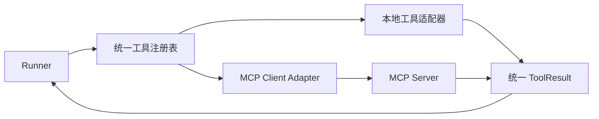

# Extensions：方法、能力与包装各有边界

## 1. 四个概念

**Skill** 保存可复用任务方法，可包含说明、参考资料和脚本；**Hook** 在运行边界执行扩展逻辑；**MCP** 定义宿主连接外部工具与资源的协议；**Plugin** 则把相关扩展打包，供安装和管理。它们处在不同边界，可以分别引入。

MVP 尚无扩展加载器，以下内容是后续设计。学习时可以先接入纯文档方法，再增加有执行效果的扩展，逐步观察权限与生命周期的变化。

## 2. Skills 的三种方案

### 全量加载

全量加载在每轮加入所有方法，实现简单，适合极少且很短的固定内容。方法增长后，输入成本和说明冲突都会增加，因此需要重新考虑加载范围。

### 元数据发现 + 正文按需加载

渐进加载先提供名称和用途，匹配任务后再读取正文，脚本与参考资料继续按需加载。它能把发现与执行分开，适合本项目下一阶段。

### 检索驱动的动态方法库

大型方法库可以按任务检索候选，再比较版本与适用范围。这样减少常驻内容，但还需要处理误触发、检索遗漏与来源治理。

[Agent Skills 规范](https://agentskills.io/specification)定义了 `SKILL.md` 元数据与渐进加载方式，实际兼容范围还取决于宿主实现。Skill 包含脚本只说明文件存在，执行权限仍需由程序单独提供。

## 3. Hooks 的两种方案

### 进程内函数

进程内函数延迟低、易测试，适合可信内置逻辑。不过它与主进程共享内存和权限，失控或阻塞的 Hook 会影响整个 Run。

### 进程外 JSON 协议

进程外协议让 Hook 接收事件 JSON，返回有限控制结果，stdout 只承载协议、stderr 承载日志。它更便于超时和隔离，也需要接口版本、输出限额与进程清理。

建议先支持 `run.start`、`tool.before`、`tool.after` 三个事件，仅允许 `tool.before` 拒绝调用。Hook 的继续结果仍需经过 Policy；安全检查失败时按拒绝处理，普通观测 Hook 则可采用明确的降级策略。

## 4. MCP 应接在哪一层



宿主发现 MCP 工具后，将定义转换为统一 `ToolSpec`，调用继续经过参数、权限、预算与结果管线。服务器自报的只读属性只是元数据，宿主还需确认实际信任与授权范围。

[MCP 架构规范](https://modelcontextprotocol.io/specification/2025-11-25/architecture)区分 Host、Client 与 Server，宿主管理连接边界；业务授权、幂等和恢复仍需在自己的系统中定义。

本地 stdio 服务器作为子进程运行，可能继承主机权限和环境变量；远程 HTTP 服务器则需要认证、连接超时和工具版本约定。两者都需要明确能访问什么数据、能产生什么效果。

## 5. Plugin 怎样包装

可以采用以下项目自定义格式。它不是跨产品通用插件标准。

```text
plugin/
  manifest.json       名称、版本、宿主接口版本、内容哈希
  skills/             方法说明
  hooks/              Hook 声明
  tools/              工具声明或 MCP 连接声明
```

安装时应检查路径、内容摘要和接口兼容性，阻止包内路径逃逸。依赖安装和脚本启动可能执行代码，需要独立受控流程；热更新时，让运行中的 Run 继续使用冻结版本，避免同一动作前后实现不同。

## 6. 动手练习

先做一个不执行脚本的 Skill 加载器。

1. 读取名称与描述。
2. 用户显式选择后，读取有界正文。
3. 保存 Skill 版本与内容摘要。
4. 把正文作为有来源的任务方法加入 Context。
5. 不新增权限，也不自动运行引用脚本。

**验收条件：** 未激活正文不进入模型请求，超大正文和路径逃逸被拒绝。随后再接只读本地 MCP 测试服务器，检查断连、Schema 变化和超大结果的行为。
