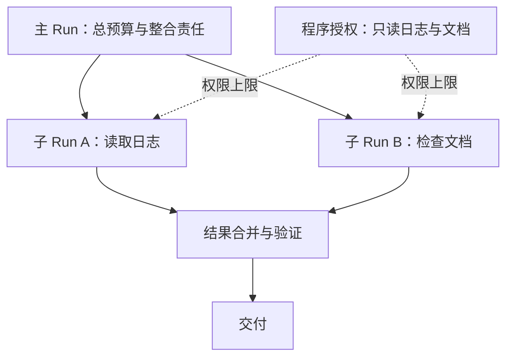

# Orchestration：何时增加多个 Agent

## 1. 先判断是否需要编排

增加角色通常会增加消息、状态与成本。先检查现有失败是否来自工具、上下文或验收标准，再判断是否确实需要多个 Agent，避免仅靠角色名称期待质量提升。

MVP 尚无多 Agent 与外部调度。后续扩展应复用同一 Runner，通过独立 Context、配置和运行身份表达角色，便于继续沿用已有权限与记录边界。

## 2. 四种协作方案

### 方案 A：Agent 作为工具

Agent 作为工具时，主 Agent 派发边界明确的子任务，子 Agent 使用独立 Context 与受限工具，返回结构化结果，由主 Agent 整合。适合日志分析、资料检索和独立评审。

这是本项目最适合先尝试的协作方式：使用同步调用，深度限制为一层，先把任务、证据、错误和预算传播做清楚。

### 方案 B：持续子会话与邮箱

持续子会话保留身份并接收后续请求，适合反复沟通的长任务。系统需要定义消息顺序、唤醒、取消和归属，区分普通通知与需要新模型调用的任务。

### 方案 C：共享任务板

共享任务板让 Agent 领取任务并更新状态，适合并行分工；同时需要领取租约、版本检查和依赖管理。文件冲突还要通过资源范围、锁或隔离工作区处理。

### 方案 D：显式 Graph 与 Handoff

Graph 根据条件选择节点并合并结果，Handoff 则转移当前交互责任，未必回到原 Agent。它们适合固定业务阶段与专家分流，交接时仍需重新检查目标 Agent 的权限。

## 3. 控制流与权限分开

子 Agent 的权限受父授权与自身配置的交集约束，Token、时间和工具用量也应计入父任务总预算。父 Run 取消后，应传播取消并确认子任务资源已经释放。

派发时只传任务、约束、必要证据和返回格式，才能保留上下文隔离的收益。子结果应带来源与不确定项，由主 Agent 检查后再用于最终结论。

## 4. 共享工作区的方案

只读任务可共享固定快照，写入不同资源时可使用资源锁；代码开发也可使用独立 Git worktree，再在合并时检查冲突与测试。方案取决于资源与修改方式。

Worktree 便于隔离 Git 修改，但不限制拥有主机权限的程序访问其他目录。因此，文件合并策略与执行安全需要分别设计。

## 5. 外层调度

Cron 适合周期任务，Webhook 适合 CI、Issue 和资料更新，持久工作流适合启动后等待事件再继续的长任务。它们管理外层触发，内部仍可使用同一 Agent Loop。

长时间等待时，保存外部任务 ID、等待条件与截止时间，再释放 Worker。事件到达后先去重、检查版本，再唤醒对应 Run，避免持续调用模型轮询。

调度器负责重叠、幂等和最大并发，也应定义哪些状态变化值得唤醒或通知；无变化的普通事件可以继续等待。

## 6. 先试哪一步

先实现一个只读 `review_document` 子 Agent 工具。

1. 主 Agent 传入文档引用与检查要求。
2. 子 Agent 读取固定文档快照。
3. 子 Agent 返回问题、证据位置和不确定项。
4. 主 Agent 合并结果并检查证据。
5. 子任务不能创建更多子任务，也不能获得写权限。

**验收条件：** 子任务超时、失败、重复结果和父取消都有确定状态，并能与单 Agent 比较质量和总 Token。看到实际收益后，再增加异步邮箱与任务板。

长任务可参考[环境初始化与交接记录实践](https://www.anthropic.com/engineering/effective-harnesses-for-long-running-agents)。其中初始化器用于首次建立环境，后续会话依靠进度记录增量继续，可以据此思考哪些准备适合一次执行、哪些检查需要每次重做。
